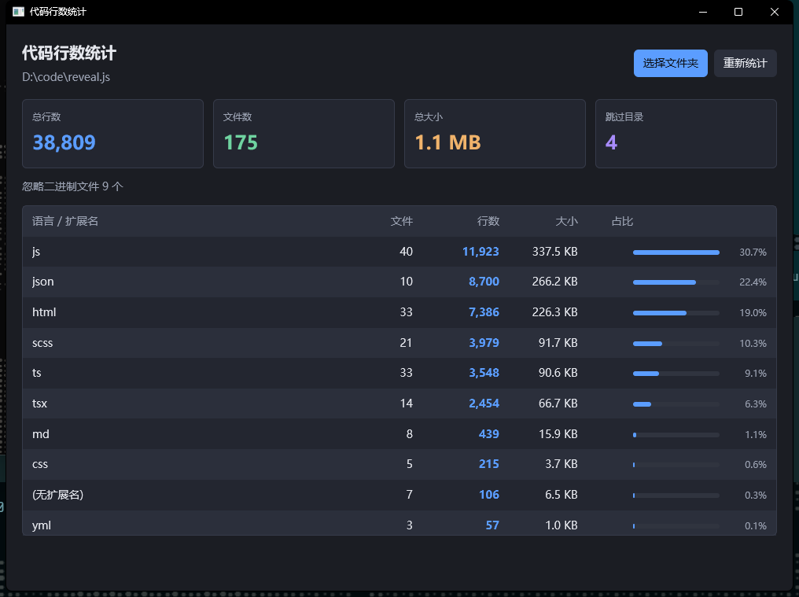

# code-count

用 Rust + [GPUI](https://docs.rs/gpui)（Zed 的 GPU 加速 UI 框架）写的代码行数统计工具。

选一个文件夹，递归统计文件数、总行数、总大小，并按扩展名分语言排行。



## 和 PowerShell 版本的关系

你原来的命令：

```powershell
(Get-ChildItem -Recurse -File | Get-Content | Measure-Object).Count
```

它在 `D:\code\code-count\src` 上得到 **1018 行 / 3 个文件**，本工具结果完全相同。行数定义刻意对齐：
`\n` 的个数，加上「最后一行没有换行符时补 1 行」。

但那个命令在真实项目上会严重失真——`D:\code\reveal.js`：

| | 文件 | 行数 |
|---|---:|---:|
| PowerShell 原命令 | 10,171 | 2,935,277 |
| 本工具 | 175 | 38,809 |

差距来自 4 个被跳过的目录（`.git` / `build` / `dist` / `node_modules`）和 9 个二进制文件。
默认跳过名单里还有 `target`、`.venv`、`__pycache__`、`.next`、`vendor`、`obj` 等，
完整列表见 `src/count.rs` 的 `DEFAULT_SKIP_DIRS`。

## 运行

```bash
cargo run --release
```

首次编译要几分钟——GPUI 的依赖树有 700 多个 crate。

`Cargo.toml` 里把 dev profile 的依赖设为 `opt-level = 3`，
否则 GPUI 在 debug 模式下会卡到没法用（这是 GPUI 项目的常规做法）。

## 命令行版本

用来核对数字，或者脚本里用：

```bash
cargo run --example stats -- D:\code\some-project
```

## 测试

```bash
cargo test
```

10 个单元测试覆盖行数定义（无尾换行、CRLF、空文件、多字节 UTF-8）、
二进制探测、扩展名分组、跳过目录、扩展名过滤。

GUI 冒烟测试（会自动操作鼠标，跑之前别动鼠标）：

```powershell
pwsh -File scripts/smoke-test.ps1 -Target D:\code\reveal.js -Out shot.png
```

它会启动应用 → 点「选择文件夹」→ 在原生对话框里输入路径 → 截图 → 退出，
用来验证窗口能画出来、按钮能点、统计结果能渲染。

## 结构

| 文件 | 作用 |
|---|---|
| `src/count.rs` | 纯统计逻辑，不依赖 GPUI，因此可以单元测试 |
| `src/main.rs` | GPUI 界面 |
| `src/lib.rs` | 把 `count` 暴露成库，供 CLI 示例复用 |
| `examples/stats.rs` | 命令行版本 |
| `scripts/smoke-test.ps1` | GUI 冒烟测试 |

## 实现要点

**不卡界面。** 统计跑在 `cx.background_executor()` 的后台线程上，通过
`smol::channel` 把进度发回 UI；UI 侧每轮把积压的进度消息合并成一条再 `cx.notify()`，
所以十万个文件也不会把重绘压垮。

**文件夹选择。** 用 `rfd::AsyncFileDialog`，await 在 GPUI 的 `cx.spawn` 里，
不阻塞主线程；弹出期间按钮变成「正在选择…」并禁用。

**行数怎么算。** 按 64 KiB 分块读，只数 `\n` 字节，
不做 UTF-8 解码——所以中文、emoji 都不会把行数算多。

**二进制探测。** 只看前 8 KiB 里有没有 NUL 字节；单文件超过 64 MiB 直接跳过。

## 可能想加的

- 自定义包含/排除的扩展名与目录（`Options` 里已经留了字段，UI 还没接）
- 导出 CSV / 复制到剪贴板
- 深色浅色主题切换
